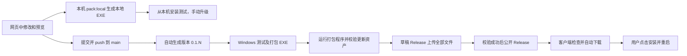

# 课堂连接：提交、构建与自动更新

## 固定的发布关系

源代码、GitHub Actions 和 Windows 安装包共用公开仓库 `buyun00/Relay-teacher-workbench`。客户端更新地址保持这个仓库名；教师录音、SQLite、连接凭据和运行状态仍在仓库外。

## 日常开发

1. 在 `uploader` 运行 `npm run dev`，浏览器迭代；需要实际文件能力时用 `npm run desktop`。
2. 修改后运行相关测试；完整检查为根目录 Python 测试和 `uploader` 的 `npm run check`。
3. 每次交付客户端改动，运行 `npm run pack:local`，提供 `uploader/release-local/` 中的新 EXE。从本机直接安装，不等待 GitHub 构建或下载安装包。
4. 提交具体改动并 `git push origin main`。本地 `git commit` 本身不会启动 GitHub 构建。
5. 查看 [Actions](https://github.com/buyun00/Relay-teacher-workbench/actions/workflows/classroom-client.yml) 的测试、打包和发布结果。全部通过后，其他电脑使用 [Releases](https://github.com/buyun00/Relay-teacher-workbench/releases/latest) 或正式客户端自动更新。

桌面标题栏由 React 的 `WindowTitleBar` 与页面共用莫兰迪背景。Electron 设置 `titleBarStyle: hidden`，通过透明 `titleBarOverlay` 保留 Windows 的最小化、最大化/还原、关闭按钮；标题内容使用 Window Controls Overlay 的 CSS 安全区域，避免遮挡窗口按钮。浏览器预览仅显示按钮外观，实际窗口操作在 Electron 中验收。关闭窗口沿用收进托盘的行为，后台上传继续；真正退出仍使用托盘菜单。实现依据为 [Electron 自定义标题栏](https://www.electronjs.org/docs/latest/tutorial/custom-title-bar)。

## 本地安装包与正式发布包

| 用途 | 构建命令（在 uploader） | 输出目录 | 版本与升级 |
| --- | --- | --- | --- |
| 本机开发和安装测试 | `npm run pack:local` | `release-local/` | `0.1.0-local.<UTC时间>`，安装新生成的本地包升级，不自动下载 GitHub 更新 |
| GitHub 正式发布 | Actions 使用 `npm run pack:win` | `release/` | `0.1.N`，公开 Release，客户端后台下载并提醒安装 |

本地构建仅通过 electron-builder 的 extraMetadata 注入本地版本和 channel，不改 package.json / lockfile，也不生成公开更新清单或发布到 GitHub。目录和文件名包含 Local，构建产物都被 Git 忽略；正式 CI 版本编号和发布资产校验维持原有流程。

两种包共用应用身份及仓库外的用户资料目录。手动覆盖安装会保留队列、副本和连接设置；本地包显示“本地包手动升级”，即使保存公开更新仓库或调用检查更新，也不会访问 GitHub。重新安装正式包后恢复自动更新。安装向导实际覆盖升级仍须单独验收。

普通修复无需手工改补丁版本，也无需打标签。`scripts/prepare-ci.cjs` 只在 CI 工作目录更新 package.json / lockfile：主/次版本来自源码，补丁版本是本 workflow 的运行编号。失败、PR 和只构建任务会消耗编号，允许跳号；重新运行同一任务不产生新版本。新功能版本可通过 `npm version minor --no-git-tag-version` 同步 package.json / lockfile，再提交。

保持 workflow 路径 `.github/workflows/classroom-client.yml` 稳定。若迁移/重建 workflow 导致运行编号重置，需要提高次版本，不能把已有发布版本覆盖。各数字受 Windows 文件版本的 65535 上限约束。

## 发布与失败恢复

Windows 构建不持有发布凭据。它验证 EXE/manifest 的版本、长度、SHA-512，并将三个更新文件的 SHA-256 和源提交记录在 build-info.json。Ubuntu 发布 job 使用当前 run 的 artifact，核对文件没有改变，确认仓库公开、源码仍是 main 最新提交，再创建草稿 Release。

四个资产都收到 GitHub 的上传完成状态、准确长度和 SHA-256 后，草稿才变成公开最新版本。网络失败、上传不完整或校验失败会停在草稿；客户端继续使用上一个完整版本。修复后在 Actions 重跑失败 job；草稿的本次资产可以补传，已公开版本不会覆盖。更新故障通过新提交生成更高版本修复。

PR 只能构建/测试。手动 workflow 默认不发布；选择 main 并勾选 publish 可发布。多个 main 构建串行处理，已落后的代码或版本不会抢占最新更新。

## 凭据与安装

当前公开仓库直接用 GitHub 自动注入的 `GITHUB_TOKEN` 发布，仅发布 job 声明 `contents: write`；不需要 `RELEASE_TOKEN`、GitHub 密码、额外个人 Token、Hermes 凭据或 ASR 凭据。

开发电脑需要一次能推送仓库及 workflow 的 GitHub 登录。本机现有 Git Credential Manager 登录已验证有写入和管理权限；命令行 API 操作可在内存中复用，不记录 Token。换电脑时可使用 `gh auth login --hostname github.com --git-protocol https --web`，由浏览器完成登录，不在聊天中提供密码或 Token。

正式安装版启动时及每 6 小时检查 GitHub；更新自动下载，下载完成后提示用户。本地安装包关闭这条下载链路。持续两分钟没有进展会取消并显示可重试的网络提示。安装必须点击确认，复制/扫描期间会等待，退出窗口不会自行安装。本地队列、音频副本、加密连接配置在用户资料目录，更新保留它们。

最初本地 0.1.0 包的更新地址为空，在设置填 `buyun00/Relay-teacher-workbench` 即可接入；后续 CI 包自带该地址。Windows Authenticode 签名尚未配置；之后选择证书或签名服务时再接入相应的签名凭据。

依据：[GitHub 同仓库 GITHUB_TOKEN](https://docs.github.com/en/actions/concepts/security/github_token)、[Release 资产与 SHA-256](https://docs.github.com/en/rest/releases/assets)、[electron-builder 自动更新](https://www.electron.build/docs/features/auto-update/)。
