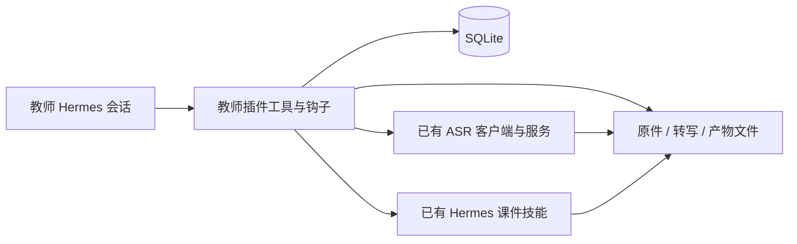

# 插件、钩子和数据库

教学功能由 `teacher-workbench` 一个插件提供。Skill 指导模型理解材料；程序工具保障资料范围、事实引用、版本、数值和任务完成条件。程序不能保证模型的教学推断总是正确，老师可以更正这些推断。

| 工具 | 用途 |
|---|---|
| teacher_context | 名单、覆盖范围、当前教师消息和持久化待确认问题 |
| teacher_import | 名单、课次、音频、转写、成绩、文档和片段关联 |
| teacher_read | 当前事件、连续片段、成绩单元格、任务及原件可用性 |
| teacher_query | 跨课次检索及程序化成绩统计 |
| teacher_record | 教学事件、教师观察、待确认问题 |
| teacher_correct | 更正当前版本，保存历史并使旧产物失效 |
| teacher_artifact | 复盘、备课、练习、学生摘要与课件保存/读取 |
| teacher_job | 任务领取、心跳、完成、恢复及同一个 ASR 任务跟进 |
| teacher_courseware | 有效备课提交给现有课件能力并查询状态 |

| 原生钩子 | 实际承担的工作 |
|---|---|
| on_session_start | 恢复已过期的执行租约 |
| pre_llm_call | 绑定本轮消息与会话，注入待确认、转写等待和就绪任务；不在钩子里阻塞等待 ASR |
| pre_tool_call | 教师入口只允许教学工具与技能读取，阻止通过终端或通用文件工具绕过业务层 |
| post_tool_call | 记录工具结果状态供审计，不复制工具正文到日志 |
| on_session_end | 清理内存中的本轮绑定；事实、问题与任务保留在 SQLite |

规则通过原生 system prompt section 加入每个新会话，同时提供可读取的插件 Skill。当前安装版本实际支持这五个钩子；没有引用不存在的接入点。

数据库包含班级、学生、班级成员、课次、内容去重原件、课次片段关系、转写版本、时间片段、教师消息、事件、待确认问题、更正历史、测验、题目映射、成绩、产物、任务和审计。数据库路径不由模型参数指定；导入路径必须位于配置的教师 inbox 或课件草稿目录。

查询使用结构化范围加 Unicode 字面子串检索，并支持显式 aliases。当前目标是一位老师的小规模资料，不安装分词或向量服务；资料增长后可以增加全文索引，不能改变现有引用 ID 与更正语义。

教师更正使用 expected_revision 防止覆盖新事实。片段文字保存在 corrected_text，不改原始转写 JSON；事件身份和事件解释分别保存。新转写版本取代同一原件的旧版本，旧版本仍留存。产物记录来源及关联课次/测验版本，更正后先失效、再按需刷新。未刷新报告不能被当作当前事实。

写入使用 SQLite WAL、foreign_keys、synchronous=FULL 和短事务。文件以临时文件、fsync、rename 保存，再登记引用；原件按 SHA-256 寻址。重复导入会核对已保存原件的内容哈希。目录、原件及数据库均与插件代码分开。

ASR 适配调用已安装的 speech_client.py，不包含模型或密钥。外部提交超时可能已经成功，因此转入 needs_attention；不自动再次提交音频。说话人标签保留为录音内的匿名标签。

课件制作是单次后台任务，调用现有 Hermes profile 的课件 Skill。只为既有终端执行 UID 开放该任务草稿目录和 brief，不开放业务数据库目录。工作目录、主 PPTX 位置明确绑定。租约心跳、实际文件、当前来源版本和 PPTX 动画/过渡/备注结构均满足后才完成任务。结构检查不能证明画面质量、答案正确或 WPS 行为。

管理员维护入口与模型工具分离。范围删除需要预览计划和匹配的 confirmation；原件被其他课次共享时保留，关联报告与任务删除，已知本地备份全部列入计划。物理清理队列保存在库内，异常后可以继续 purge。
