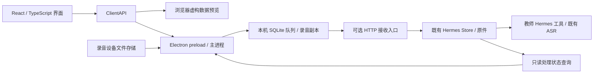

# 课堂连接 · Windows 客户端 0.1.0

从 DJI Mic Mini 2S 等录音设备读取**已经保存的音频文件**，也可以手动选择本机音频，先复制到本机，再可靠上传。安装包为 Windows x64 NSIS EXE，窗口关闭时留在系统托盘，托盘菜单可以真正退出。

主界面左侧是任务列表，右侧是对话区。一个任务对应一个持久化 Hermes 会话；真实流式文本、工具步骤与结果、停止回复、断线重连和重开后的历史恢复共用同一会话。默认由 DeepSeek Flash 先了解需求，第 2 轮信息足够时选定后续模型，最迟第 3 轮选择；选定后固定，顶部也可手动指定或重新选择“自动”。支持 Markdown、代码块、表格和数学公式。Enter 发送、Shift + Enter 换行，中文输入法选字不触发发送。浏览器模式仍使用明确标注的虚构回复演示。

鼠标移到左侧对话，可点击右侧归档图标；左下角“已归档”可查看并恢复。归档保留对话历史、固定模型和本机草稿，正在运行的回复继续执行；恢复后沿用同一会话。DS 在需求明确时根据内容自动生成简短标题，随后保留该标题，问候语不会固定成主题。莫兰迪鼠尾草绿、雾蓝与淡粉背景配合大圆角玻璃卡片；新对话的引导内容在右侧可用区域居中。

另一个入口是“录音上传”：集中显示设备是否接入、待上传录音和当前上传状态，提供手动上传。连接、更新及录音目录设置集中在“设置”弹窗，文件明细和更多设置默认折叠。后端连接与模型配置见 [对话开发说明](../docs/desktop-chat.md)。

## 架构与开发



界面只依赖 `src/types.ts` 中的 `ClientAPI`。浏览器使用 `src/bridge.ts` 的**明确标注为虚构数据**的预览适配器；Electron 使用 `electron/preload.cjs` 的原生桥，文件、SQLite、网络凭据及更新都在主进程处理。页面的 Node 集成关闭，开启上下文隔离和沙箱；打包后通过本地 `classroom://app` 协议加载同一份 Vite 产物。以后增加教室面板操作时，可以添加页面和独立的设备适配器，继续使用这个边界。

要求 Node.js 24+、npm；测试接收端还需要 Python 3.11+。自动化测试使用明确虚构的数据；真实录音验收在仓库外独立资料目录进行。

```powershell
cd D:\hermes-teacher\uploader
npm ci
npm run dev        # http://127.0.0.1:5178，浏览器界面预览
npm run desktop    # 同一开发界面，启用实际 Electron 文件能力
npm run check      # TypeScript / 构建、Node 队列与传输测试、浏览器交互
node tests/electron-smoke.cjs
npm run pack:local # release-local/Hermes-Classroom-Local-<本地版本>-x64-Setup.exe
# pack:win 留给正式发布构建：release/Hermes-Classroom-<正式版本>-x64-Setup.exe
```

浏览器测试首次运行前执行 `npx playwright install chromium`。Windows 本机只有 Python launcher 时使用 `py`；CI 使用 `python`。Electron 下载使用 npm 官方包内的校验值；没有把二进制、node_modules、构建目录或运行资料提交到 Git。

本地开发交付包含可直接安装的 EXE，使用 `npm run pack:local`，无需去 GitHub 下载。它写入独立的 `release-local/`，版本带 `-local.<UTC时间>`；只修改打包后的版本信息，不修改源码版本或 lockfile，不发布 Release，不自动检查或下载 GitHub 更新。设置页标明本地包，后续安装新生成的本地 EXE 即可升级。

本地包与正式包使用同一应用身份和用户资料目录，可以手动覆盖安装并保留队列、录音副本和连接设置；安装正式包后恢复 GitHub 自动更新。两种构建输出分别管理，不提交任何安装包或运行数据。

## 首次使用

1. 点击左下角“设置”，填写录音接收地址、教师空间 ID；接收端配置了 Bearer 凭据时填写同一凭据。保存后自动检查连接，在弹窗内显示实际连接结果。
2. 点击“录音上传”。可以直接点右上角“手动上传”，多选本机音频文件；取消选择不会添加记录。客户端仅复制选中的文件，不绑定其目录或扫描旁边的其他文件，显示新增、重复和失败数量。手动上传与设备上传共用内容去重、队列、续传和持久化回执；没有配置接收端或已暂停时仍可先添加文件。
3. 使用设备时，用数据线或设备支持的导出连接接入设备，在同一页点击“选择录音目录”绑定磁盘中的录音目录。绑定可移动卷的稳定 ID，盘符变化后仍可匹配；另一个设备占用旧盘符不会继承绑定。也可绑定普通录音文件夹。客户端每 4 秒扫描，等待文件大小、修改时间等在两次观察中稳定，并在复制前后检查是否仍相同。复制到 staging，流式计算内容 SHA-256，fsync 后改名，再登记队列。**已完成本地复制的文件**无需继续连接设备即可上传。
4. 上传每次发送最多 4 MiB，从接收端已持久化的字节偏移继续；暂时离线时按退避间隔重试，凭据/协议错误显示“需要处理”。队列、偏移及回执在退出、重启和升级后保留。
5. 接收端实际保存原件后才返回包含 `upload_id + sha256 + byte_length + workspace_id + asset_id` 的回执。客户端逐项匹配后确认上传。启用自动处理的接收端随后复用既有 ASR 和教师插件生成复盘、15分钟补充备课，文件明细显示当前处理阶段。
6. 展开“录音文件”，完成的录音点击“查看结果”，阅读已保存的复盘和备课。处理中每5秒查询一次状态，其余每分钟查询；暂停上传仍可查看服务器处理进展。状态查询和读取结果只发送录音标识，不重传音频或重新发起分析。文件分段与课次不同，一个课次可关联多个文件或片段；客户端不猜班级、学生和课次，可在教师入口中另行关联。

自动扫描仅按扩展名识别常用音频文件；手动选择提供音频筛选和“所有文件”，不增加既有教师导入的媒体、大小或目录门槛。原件不会删除。相同内容改名不会重复入库，同名内容变化会成为另一条录音；文件名、大小和修改时间只是便于跳过已见文件的快速索引，时间重置等情况下若所有元数据都碰巧相同，可能漏检，需真实设备验收。没有设备提供的“录制完成”信号，因此文件稳定性判断也需要真机验证；USB 导出时能否继续内录尚未确认。设备识别或目录读取失败时显示问题，不把未知设备状态当作没有录音。

设备循环覆盖之前未复制的录音无法恢复。本版保留全部本地副本，尚未实现保留天数或自动清理；不要删除未收到匹配回执的 staging 文件。解除设备绑定只移除绑定，不删除副本或队列。

## 数据位置与凭据

默认数据目录使用 Electron `app.getPath('userData')`，Windows 通常在 `%APPDATA%\Hermes Classroom`，可通过“设置 → 更多设置 → 打开本地资料”打开。目录内是 `queue.sqlite`、WAL 以及 `staging/`，与安装目录、Git 仓库分开。本机任务草稿、待确认发送标识及对话缓存也保存在同一 SQLite 中；真正的模型历史由服务端原生 Hermes SessionDB 保存，业务完成仍以教师 Store 的有效产物和任务状态为准。卸载器保留应用数据；更新不会迁移或清空队列。显式 `--user-data-dir=<绝对目录>` 可选择独立验收空间。

连接凭据用 Electron `safeStorage`（Windows DPAPI）加密，仅主进程解密使用。界面只能看到“是否已保存”，不会回读明文；源码、日志和发布资产都不包含凭据。浏览器预览不保存或使用输入的凭据。

## 可选接收入口

`workbench/ingress.py` 是标准库 HTTP 入口，使用既有 Store；`--auto-process` 启用持久化录音流程，调用现有 ASR 和教师原生工具。未启用该参数时只接收和查询，不发起分析。实际部署使用教师 profile 的配置和数据根目录，详见 [录音处理说明](../docs/recording-workflow.md)。

在仓库根目录开发验证，可指定仓库外的临时目录：

```powershell
py -X utf8 -m workbench.ingress --root "$env:TEMP\fictional-classroom-receiver" --port 8766
```

默认只监听 `127.0.0.1`。当前 H3 部署通过独立 `teacher-recordings.service` 提供内网 `10.100.0.169:8767`，教师空间为 `teacher`。Bearer 凭据从 `HERMES_UPLOADER_TOKEN` 环境变量读取，保持在运行环境中，不写入仓库。服务不打印凭据、录音名称或业务正文到访问日志；无需挂载 Docker socket 或修改 Hermes 核心。

协议 v1：

| 请求 | 数据 / 持久化条件 |
| --- | --- |
| `GET /v1/health` | 协议版本和教师空间 ID |
| `GET /v1/recordings/<sha256>/results` | 读取此录音已保存的当前复盘、备课正文；返回教师空间与原件标识 |
| `POST /v1/uploads` | JSON 内容标识、长度、文件名、客户端及教师空间；返回稳定上传 ID、已保存偏移、可选最终回执 |
| `PUT /v1/uploads/<id>?offset=N` | 二进制段；文件 fsync 之后提交 SQLite 偏移。崩溃尾部在下次写入前按已提交偏移截断 |
| `POST /v1/uploads/<id>/complete` | 验证本次新传输的内容完整性，调用 Store.ingest 保存原件，再提交回执。校验不复核已保存原件 |
| `GET /v1/uploads/<id>` | 当前偏移及最终回执 |
| `POST /v1/status` | JSON `{workspace_id, sha256: [...]}`；读取原件、课次、转写、任务及当前版本有效的复盘记录 |

完成入库但最终回执丢失时，客户端重复创建同一内容的会话即可取回回执，无需重传。原件提交后、回执提交前崩溃，也可以通过内容去重恢复。部分传输丢失时退回 0 重传；未知、不匹配回执不会使本地资料完成。

接收协议的教学状态包括待关联课次、已入库、等待处理、转写中、转写已保存、复盘中、复盘已保存、复盘待刷新和需核查。复盘状态来自真实已保存且来源版本仍有效的报告，不由任务文本或 HTTP 接受决定。教师更正后旧产物 stale，下一次元数据查询会取得待刷新状态。精简上传页的文件明细同时显示处理阶段，提供只读结果弹窗。

## GitHub Actions 构建与公开更新

源码仓库 `buyun00/Relay-teacher-workbench` 已公开，安装包直接发布在同一仓库的 Releases。无需另建仓库、配置发布变量或保存个人 Token：仅发布 job 获得同仓库 `GITHUB_TOKEN` 的 `contents: write`，测试/构建 job 为只读；发布凭据不会传给打包步骤或进入 EXE。

修改后提交并 **push 到 main**，相关源码变更会自动触发 `.github/workflows/classroom-client.yml`：

1. 从 `package.json` 取得主版本/次版本，用 GitHub workflow 的 `run_number` 作为补丁版本。例如源码 `0.1.0`、运行编号 `42` 生成 `0.1.42`；自动同步本次工作目录的 lockfile，不回写版本提交、不需要手工打标签。重跑同一 run 保持同一版本，编号允许跳号。
2. Windows runner 执行 Python、队列/传输/发布规则、浏览器和 Electron 开发运行检查，再打 NSIS x64 包；随后用真实打包 EXE 复验复制、拔盘后上传、回执和重启。
3. 核对 `latest.yml` 与 EXE 的版本、文件大小、SHA-512，生成 `build-info.json` 记录源码 SHA 和资产 SHA-256；构建 artifact 保留 14 天。
4. 创建业务快照清单 classroom-update.json 和按内容寻址的 content-<SHA256>.br 文件，同时为首次安装生成 EXE、blockmap、latest.yml。校验全部内容及源码来源，测试打包 EXE 从业务版本 A 自动更新到 B。
5. 创建 v0.1.42 草稿 Release，上传业务清单、内容文件、首次安装资产和 build-info.json。GitHub 确认全部资产的长度和 SHA-256 后，才公开为最新版本；失败留在草稿，不被客户端发现。

PR 只构建/测试，不公开更新。手动运行 workflow 默认只构建；在 main 勾选 publish 可发布。发布前后检查 main 提交，过时构建不会发布；较旧版本重跑也不会抢占最新版本。已经公开的同一版本不覆盖安装包，重跑会保留原 Release。并发 main 构建按队列执行，PR 新提交可取消旧检查。

正式 CI 包的默认更新地址是 `buyun00/Relay-teacher-workbench`；`pack:local` 的本地包关闭 GitHub 更新。最初制作的 0.1.0 包没有内置这个地址，需要在“设置 → 更多设置”填一次；之后的 CI 版本自带地址。以后升级主/次版本时修改 package.json 与 lockfile；保持 workflow 文件路径稳定以保留运行编号。Windows 版本各段必须不超过 65535。完整开发、恢复和凭据说明见 [发布流程](../docs/classroom-client-release.md)。

正式安装版启动后检查更新，此后每 6 小时检查；客户端只读取业务清单，复用本地未变文件，下载变化的 Brotli 内容。它不请求 Setup.exe、blockmap 或 latest.yml，也不启动安装程序。新内容准备好后发系统提示，下次启动自动启用；设置页提供“重启启用新内容”。持续两分钟没有进展会取消并允许重试，已完整校验的新内容在重试时复用。复制、扫描或对话执行期间暂缓立即重启，队列、草稿、副本和连接设置保留在原资料目录。浏览器、开发运行和 Local 包不访问 GitHub 更新。

稳定底座 electron/bootstrap.cjs 和 electron/shell/ 加载完整业务快照；可更新内容包括 React 资源、Electron 主进程业务代码、preload、core 模块和图片。只有界面与队列都启动成功才会确认新版本，启动失败或代码损坏会回退。普通发布保持底座指纹相同；Electron、加载器或原生库变化必须明确发布底座，客户端继续使用原版本并显示不兼容，绝不退回自动安装。旧客户端需要一次升级以进入新机制。详见[发布流程](../docs/classroom-client-release.md)。

本机可复用 Git Credential Manager 已保存的 GitHub 登录完成首次部署；不用把 Token 粘贴到聊天、源码或安装包。当前 EXE 未做 Authenticode 签名。代码签名证书是后续改善 Windows 安装体验的独立配置，不是当前自动打包/更新所需凭据。远端首次运行和公开更新的实测结果记录在 `docs/acceptance.md`。

实现依据：[Electron 进程模型](https://www.electronjs.org/docs/latest/tutorial/process-model)、[上下文隔离与安全](https://www.electronjs.org/docs/latest/tutorial/security)、[electron-builder 自动更新](https://www.electron.build/docs/features/auto-update/)、[Electron safeStorage](https://www.electronjs.org/docs/latest/api/safe-storage)。

## 验收边界

`tests/*.test.cjs` 使用临时虚构文件与实际 Python HTTP 接收入口，覆盖改名去重、同名替换、复制中变化、稳定观察、手动多文件导入与自动扫描串行、任务草稿持久化、重启、丢失副本、盘符复用、分段续传、回执丢失/不匹配、凭据错误和内容更新原子切换。`tests/ui` 验证任务与草稿、上传状态和手动入口、暂停、折叠设置及预览凭据不落盘；`tests/electron-smoke.cjs` 检查真实 Electron 界面协议、沙箱、桥、SQLite 与 Windows 凭据加密，通过设备和手动多选复制、取消选择、重复导入、移除源目录后上传、回执/状态及重启验证。

正式包还须运行 node tests/content-update-smoke.cjs，使用临时虚构队列和草稿，核对真实 EXE 从 GitHub 格式的模拟 Release 只下载变化内容，普通退出后加载新版主进程业务、preload 和界面，EXE 本身不变，资料仍可读取。

检查本地包的实际 EXE 时设置 `CLASSROOM_PACKAGED_EXE` 指向 `release-local/win-unpacked/Hermes Classroom.exe`，正式包则指向 `release/win-unpacked/Hermes Classroom.exe`，再运行同一脚本。脚本通过显式独立 user-data-dir 使用临时虚构数据，不触碰默认教师资料或系统登录启动设置。

Python 原生工具和虚构教学资料测试覆盖实际入队、同一 ASR 任务跟进、恢复部分产物、原生工具保存绑定、旧引用拒绝、备份恢复、范围删除与共享原件保留。真实课堂音频的完整上传/ASR/Hermes/客户端回读结果见 `docs/acceptance.md`，与虚构测试分开记录。实际 DJI 硬件、USB 导出行为、转写及教学准确性需要现场验收。
